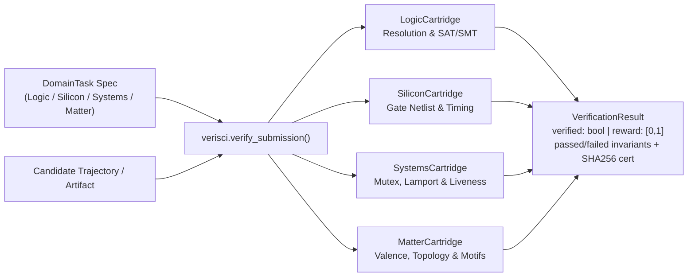

# `verisci` — Universal Scientific & Formal Verification Cartridges

> **Pillar 6 of the Next-Gen Verifiable AI Architecture**: Pluggable, zero-hallucination formal verification engines extending RLVR (Reinforcement Learning from Verifiable Rewards) and inference-time search across **Formal Logic**, **Silicon Digital Design**, **Concurrent Distributed Systems**, and **Computational Matter**.

---

## Architecture Overview



---

## The 4 Verification Cartridges

| Cartridge | Domain Key | Ground-Truth Formal Invariants Checked |
| :--- | :--- | :--- |
| **Formal Logic & SMT** | `logic` | Propositional resolution soundness, tautology filtering, goal clause derivation, and exact CNF SAT truth assignment verification. |
| **Hardware & Silicon** | `silicon` | Topological acyclicity, single-driver discipline, exhaustive $2^N$ truth-table equivalence, gate budget, and critical-path depth. |
| **Systems & Concurrency** | `systems` | Mutual exclusion, lock ownership discipline, Lamport causal clock monotonicity, bounded buffer safety, quorum liveness, and deadlock-free termination. |
| **Computational Matter** | `matter` | Atomic stoichiometry conservation, exact covalent valence rules (`C=4, N=3, O=2, H=1, Hal=1`), single-component BFS connectivity, cyclomatic ring count, and functional group motifs. |

---

## Quickstart

```bash
# Run the full verification test suite
PYTHONPATH=src python3 -m unittest discover -s tests -v

# List registered cartridges via CLI
PYTHONPATH=src python3 -m verisci.cli domains
```
